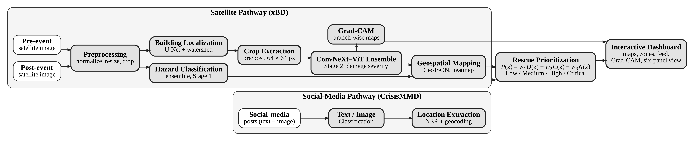
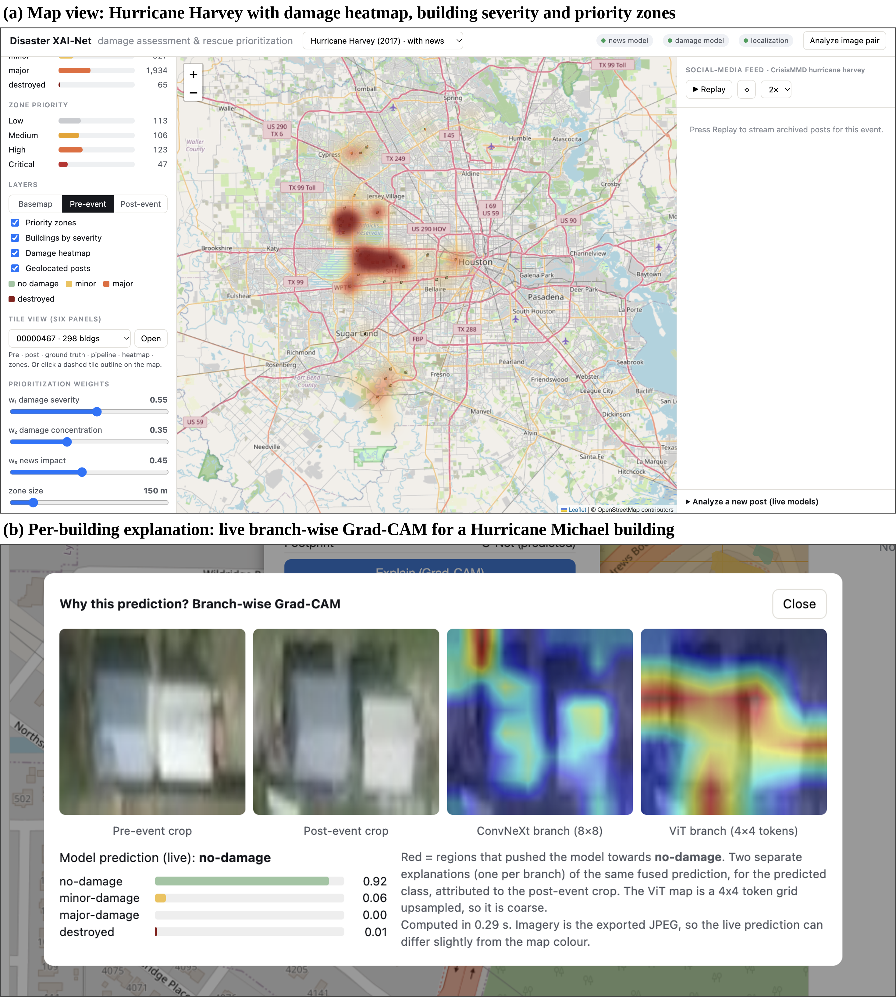
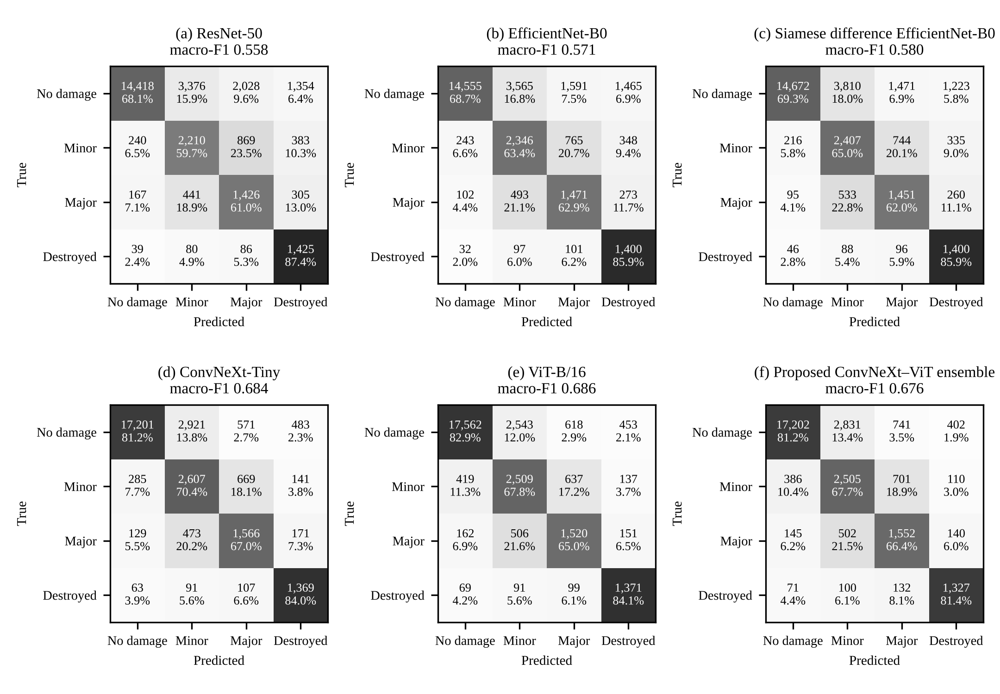

# Disaster XAI-Net

**Satellite Imagery-Driven Multi-Disaster Impact Assessment and Rescue Prioritization**

Disaster XAI-Net turns a pair of pre- and post-disaster satellite images into building damage maps, visual explanations and ranked rescue-priority zones, supported by evidence from social-media posts. Everything comes together in an interactive dashboard that runs on a laptop CPU.



## Features

- **Hazard classification.** Labels each image tile as cyclone, earthquake, flood or wildfire.
- **Building localization.** A U-Net with a ResNet-34 encoder finds buildings in the pre-event image, and a border-aware watershed separates touching roofs.
- **Damage grading.** A jointly trained **ConvNeXt–ViT hybrid** (Siamese ConvNeXt-Tiny + Siamese ViT-B/16, LayerNorm fusion, MLP head) grades every building as no damage, minor, major or destroyed.
- **Explainability.** Branch-wise Grad-CAM shows one ConvNeXt map and one ViT map for each prediction.
- **Rescue prioritization.** 150 m zones are scored with `P = w1·D + w2·C + w3·N` (damage severity, damage concentration, social-media evidence) and labelled Low / Medium / High / Critical.
- **Social media.** DistilRoBERTa text classifiers and a ConvNeXt image classifier are trained on CrisisMMD. Locations come from BERT NER and Nominatim geocoding.
- **Dashboard.** Built with FastAPI and Leaflet. It shows severity footprints, a heatmap and priority zones, has live weight sliders, a per-building Grad-CAM view and a six-panel tile view, can replay the social-media feed, and analyses a new post or image pair live.



## Results (held-out test set: 537 tiles, 28,847 buildings)

| Model | Hazard acc. | Severity macro-F1 | QWK | Binary F1 |
|---|---|---|---|---|
| ResNet-50 | 0.991 | 0.558 | 0.520 | 0.695 |
| EfficientNet-B0 | 0.993 | 0.571 | 0.530 | 0.701 |
| Siamese difference network | 0.996 | 0.580 | 0.557 | 0.716 |
| ConvNeXt-Tiny | 1.000 | 0.684 | 0.724 | 0.811 |
| ViT-B/16 | 0.998 | 0.686 | 0.725 | 0.814 |
| **ConvNeXt–ViT hybrid (proposed)** | 0.998 | 0.676 | 0.718 | 0.811 |

- **Modern backbones are clearly better.** ConvNeXt, ViT and the hybrid beat the older CNNs by 0.10–0.13 macro-F1 (p < 0.001, paired tile bootstrap). They mainly do so by raising far fewer false alarms on intact buildings.
- **The hybrid matches its parts but does not beat them.** It is on par with its two constituents, not better, and it detects 93.7 % of damaged buildings.
- **Localization:** building F1 0.648 (pixel F1 0.857). End to end, damage macro-F1 is 0.694 on predicted footprints vs 0.700 on annotated ones.
- **Prioritization:** agreement with label-derived priorities is Spearman ρ = 0.818 on 407 tiles. Changing the weights by ±20 % keeps ρ ≥ 0.993.

The five comparison models were trained separately on identical tile-grouped folds; they are not part of the hybrid.



## Repository structure

```
disaster-xai-net/
├── backend/                 FastAPI app, prioritization, Grad-CAM, six-panel renderer
├── frontend/                index.html + vendor/ (Leaflet, works offline)
├── notebooks/
│   ├── Disaster_XAI_Net_Demo_Data_Export.ipynb   builds demo_data/ on Kaggle
│   ├── Disaster_XAI_Net_Six_Panel_Figure.ipynb
│   └── training/            ensemble, ResNet-50, EfficientNet-B0, Siamese difference,
│                            U-Net localization (+ tuning), CrisisMMD NLP, significance tests
├── docs/images/             figures used in this README
├── prepare_demo_data.py
├── requirements.txt
└── run.sh
```

`demo_data/` and `models/` are **not included** in this repository because they are large. See the setup steps below.

## Setup

### 1. Get the demo data
Run `notebooks/Disaster_XAI_Net_Demo_Data_Export.ipynb` on Kaggle with the xBD data, localization output and CrisisMMD output attached, and Internet ON. Download `demo_data.zip` and unzip it into the repository root so that `demo_data/index.json` exists.

### 2. Install and run the dashboard
```bash
python3 -m venv .venv
source .venv/bin/activate
pip install fastapi uvicorn python-multipart numpy pillow ftfy scipy matplotlib
chmod +x run.sh
./run.sh            # http://localhost:8000   (another port: PORT=8001 ./run.sh)
```

### 3. Optional: live models (Grad-CAM, "Analyze a new post", "Analyze image pair")
```bash
pip install -r requirements.txt
```
Place the trained bundles exported from the Kaggle notebooks here:
```
models/
├── deployment_bundle/      inference.py + ConvNeXt–ViT weights   (Grad-CAM, damage)
├── localization_bundle/    localization_inference.py, unet_localization.pth, postprocess_config.json
└── news_bundle/            news_inference.py + text/image weights
```
Check what loaded at `http://localhost:8000/api/status`. Without these files the dashboard still works on the precomputed data.

## Datasets

- **xBD / xView2.** R. Gupta et al., "Creating xBD: A dataset for assessing building damage from satellite imagery," CVPRW 2019. Eight events were used: hurricanes Florence, Harvey, Matthew and Michael, the Mexico earthquake, the Midwest flooding, and the Santa Rosa and SoCal wildfires.
- **CrisisMMD v2.0.** F. Alam, F. Ofli and M. Imran, "CrisisMMD: Multimodal Twitter datasets from natural disasters," ICWSM 2018.

Both datasets are subject to their own licences and are not redistributed here.

## Limitations

- Test tiles come from the same eight events as training, so performance on unseen disasters has not been measured.
- Prioritization weights are expert-set defaults that have not been calibrated on real rescue records. The zones are decision-support indicators.
- The dashboard is a prototype that has not yet been evaluated with emergency-management practitioners.

## License and citation

The code is released under the [MIT License](LICENSE). You may use, modify and share it, but **every copy or derived version must keep the copyright notice with the authors' names**.

If you use this code or build on this work in a project, report or paper, please cite it. Use GitHub's **"Cite this repository"** button (from [CITATION.cff](CITATION.cff)), or:

> S. Patkar, S. Gandhi, L. Modak, A. Jare and F. Rangari, "Disaster XAI-Net: Satellite Imagery-Driven Multi-Disaster Impact Assessment and Rescue Prioritization," Vidyalankar Institute of Technology, Mumbai, 2026. [Online]. Available: https://github.com/ShriyaPatkar/Disaster-XAI-Net

The datasets (xBD, CrisisMMD) are not covered by this license and keep their own terms.

## Team

Final-year B.E. project, Department of Electronics & Computer Science, Vidyalankar Institute of Technology, Mumbai (2026–27).

Shriya Patkar · Swarali Gandhi · Lubdha Modak · Ayush Jare. Guide: Prof. Faiz Rangari.
